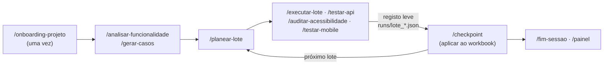

# qa-assistant

Uma framework de QA para trabalhar com o [Claude Code](https://claude.com/claude-code): a metodologia, as técnicas de teste e as ferramentas vivem aqui, e cada projeto real vive num **workspace** separado, fora deste repositório. O assistente segue a metodologia através de skills (`/onboarding-projeto`, `/executar-lote`, `/checkpoint`, …) e escreve os resultados no tracker do projeto por adaptadores verificados por testes.

Tudo está em português europeu.

---

## Arquitetura em camadas

| Camada | O que é | Onde vive |
|---|---|---|
| **1. Metodologia** | O método: análise, desenho de casos, lotes, regras de decisão (Pass/Fail/N/A/Blocked/Dúvida), bugs, checkpoints | [`docs/metodologia-core.md`](docs/metodologia-core.md) |
| **2. Técnicas** | Como testar cada tipo: [browser](docs/tecnica-browser.md), [API](docs/tecnica-api.md), [acessibilidade](docs/tecnica-acessibilidade.md), [mobile](docs/tecnica-mobile.md), [workbooks Excel](docs/tecnica-excel.md) | `docs/` |
| **3. Adaptadores e ferramentas** | Adaptador Excel universal, scripts de API, acessibilidade, mobile e painel; skills | `adapters/`, `scripts/`, `tools/`, `.claude/skills/` |
| **4. Workspace** | O projeto: `CLAUDE.md`, `projeto.yaml`, `contexto.md`, workbook, `.env`, registo leve | `qa-workspaces/<empresa>/<projeto>/` (fora daqui) |

A hierarquia de fontes de verdade, a regra de generalização (o que é universal vs. o que é de um projeto) e o processo para alterar a framework estão na metodologia (§1.3, §1.4, §15).

## Fronteira de privacidade

Nada que identifique um cliente entra neste repositório: nomes, URLs de ambientes, contas, credenciais, workbooks, resultados ou bugs de projetos reais. Duas barreiras no `pre-commit`, que nunca se contornam:

- **detect-secrets**, com baseline;
- **denylist pessoal** (`~/.qa-denylist.txt`, fora do repositório): bloqueia nomes de clientes no texto, nos nomes dos ficheiros e **dentro** de ficheiros Office (`.xlsx`, `.docx`, `.pptx`).

As credenciais vivem só no `.env` de cada workspace e são referidas pelo nome da variável. Os scripts passam-nas por variáveis de ambiente, nunca pela linha de comandos, e redigem a evidência (ex.: `scripts/api_pedido.py` troca tokens e palavras-passe por `«redigido»`).

## Como trabalhar

Os casos gerados são propostas até o utilizador os aprovar; um bug só é criado depois de aprovado; os resultados passam ao workbook apenas no checkpoint, pelo adaptador, e só se o lote for válido e o cross-check der 0 problemas.

### Começar um projeto novo

1. Criar a pasta `qa-workspaces/<empresa>/<projeto>/` (ao lado deste repositório).
2. Abrir o `claude` nessa pasta e correr `/onboarding-projeto`: cria o `CLAUDE.md` e o `projeto.yaml`, pergunta ambientes, roles, tracker e módulos, inspeciona o workbook real (`python -m adapters.excel.inspecionar`), regista o Playwright MCP e acaba com `python scripts/validar_projeto.py <workspace>` sem problemas.
3. Preencher o `.env` localmente.

### Módulos

| Módulo | Técnica | Skill | Ferramenta |
|---|---|---|---|
| `funcional-web`, `exploratorio` | browser | `/executar-lote` | Playwright MCP |
| `api` | API | `/testar-api` | `scripts/api_pedido.py` |
| `acessibilidade` | WCAG 2.1 AA | `/auditar-acessibilidade` | `scripts/auditar_a11y.py` (axe-core) |
| `mobile` | Maestro | `/testar-mobile` | `scripts/testar_mobile.py` |

## Demo

[`examples/demo/`](examples/demo) é um workspace completo contra sites públicos de prática ([saucedemo.com](https://www.saucedemo.com) e a API [restful-booker](https://restful-booker.herokuapp.com)), com 38 casos em 6 áreas, lotes executados em `runs/`, 3 bugs de exemplo, flows Maestro e specs Playwright de regressão (`e2e/`). O workbook reconstrói-se a partir do gerador e dos lotes (`python examples/demo/reconstruir_workbook.py`), e `python scripts/gerar_painel.py examples/demo --abrir` mostra o painel de progresso.

## Testes e CI

- `python -m unittest discover -s tests` — testes unitários (adaptador, painel, resumo, API, acessibilidade, mobile, validação, denylist, skills).
- `python scripts/golden_check.py` — teste golden do adaptador Excel (precisa de LibreOffice).
- O CI (GitHub Actions) corre lint (ruff), testes, detect-secrets e o golden em cada push; o `pre-commit` corre o mesmo localmente, mais a denylist.

Requisitos: Python 3.12+ (`pip install -r requirements.txt`), LibreOffice (recálculo de workbooks), Node.js 22+ (acessibilidade e specs), Maestro CLI (mobile).

## Estado

O roadmap e o estado de cada tarefa estão em [`docs/plano-desenvolvimento.md`](docs/plano-desenvolvimento.md).
