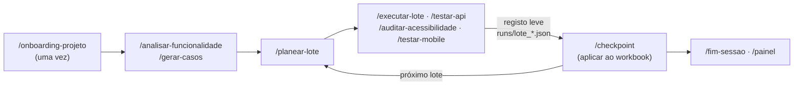

# qa-assistant

[](https://github.com/pedroalmeida981/qa-assistant/actions/workflows/ci.yml)

Uma framework de QA para trabalhar com o [Claude Code](https://claude.com/claude-code): a metodologia, as técnicas de teste e as ferramentas vivem aqui, e cada projeto real vive num **workspace** separado, fora deste repositório. O assistente segue a metodologia através de skills (`/onboarding-projeto`, `/executar-lote`, `/checkpoint`, …) e escreve os resultados no tracker do projeto por adaptadores verificados por testes.

A camada de workspace está em português europeu; o motor `qa-audit` (abaixo) está em inglês.

---

## qa-audit — automated audit engine

An automated first pass over any website, from its URL alone. It lives alongside the workspace layer.

```bash
./scripts/install.sh            # Windows: .\scripts\install.ps1  (.venv, package, Chromium, then qa-audit doctor)
. .venv/bin/activate            # Windows: .\.venv\Scripts\Activate.ps1
qa-audit https://example.com                         # every available module
qa-audit https://example.com --type accessibility --browser firefox --max-pages 5
```

It can log in first (a form, or you log in by hand for Active Directory / 2FA). It crawls the start origin with GET navigation only (never clicks, types or submits; skips logout/delete-style
links, respects `robots.txt`), runs the selected modules on each page, and writes `qa-output/<timestamp>/` with
screenshots, `results.json`, `results.csv`, `report.md` and a self-contained `report.html`. No telemetry; nothing
is sent anywhere but to the target. Only audit sites you own or are authorized to test.

Modules today: **accessibility** (axe-core 4.13.0 bundled, keyboard walk, reflow, manual checklist) and
**security** (passive: HTTPS/TLS, security headers, cookie flags, mixed content) and **performance** (TTFB, FCP,
LCP, CLS against the web.dev thresholds; sizes and timings measured) and **functional** (broken links and
resources, JavaScript errors, redirect chains, form checks; forms are submitted only with `--allow-submit` and when
listed in the configuration) and **visual** (screenshots per viewport against baselines kept outside any
repository, horizontal overflow; `pip install -e .[visual]`). User guide: [`docs/qa-audit-guide.md`](docs/qa-audit-guide.md) (install, run, results, new projects, new modules,
client data); example: [`examples/qa-audit/`](examples/qa-audit/). Specification: [`docs/qa-audit.md`](docs/qa-audit.md);
contributing: [`CONTRIBUTING.md`](CONTRIBUTING.md); changes: [`CHANGELOG.md`](CHANGELOG.md).

---

## Arquitetura em camadas

| Camada | O que é | Onde vive |
|---|---|---|
| **1. Metodologia** | O método: análise, desenho de casos, lotes, regras de decisão (Pass/Fail/N/A/Blocked/Dúvida), bugs, checkpoints; heurísticas anonimizadas para o *error guessing* | [`docs/metodologia-core.md`](docs/metodologia-core.md), [`docs/heuristicas.md`](docs/heuristicas.md) |
| **2. Técnicas** | Como testar cada tipo: [browser](docs/tecnica-browser.md), [API](docs/tecnica-api.md), [acessibilidade](docs/tecnica-acessibilidade.md), [mobile](docs/tecnica-mobile.md), [workbooks Excel](docs/tecnica-excel.md) | `docs/` |
| **3. Adaptadores e ferramentas** | Adaptador Excel universal, scripts de API, acessibilidade, mobile, painel e validação; skills. São o motor da framework: não há um núcleo à parte | `adapters/`, `scripts/`, `tools/`, `.claude/skills/` |
| **4. Workspace** | O projeto: `CLAUDE.md`, `projeto.yaml`, `contexto.md`, workbook, `.env`, registo leve | `qa-workspaces/<empresa>/<projeto>/` (fora daqui) |

A hierarquia de fontes de verdade, a regra de generalização (o que é universal vs. o que é de um projeto) e o processo para alterar a framework estão na metodologia (§1.3, §1.4, §15).

## Fronteira de privacidade

Nada que identifique um cliente entra neste repositório: nomes, URLs de ambientes, contas, credenciais, workbooks, resultados ou bugs de projetos reais. Duas barreiras no `pre-commit`, que nunca se contornam:

- **detect-secrets**, com baseline;
- **denylist pessoal** (`~/.qa-denylist.txt`, fora do repositório): bloqueia nomes de clientes no texto, nos nomes dos ficheiros e **dentro** de ficheiros Office (`.xlsx`, `.docx`, `.pptx`).

As credenciais vivem só no `.env` de cada workspace e são referidas pelo nome da variável. Os scripts passam-nas por variáveis de ambiente, nunca pela linha de comandos, e redigem a evidência (ex.: `scripts/api_pedido.py` troca tokens e palavras-passe por `«redigido»`). No workspace, o `validar_projeto` avisa se o `.env` e afins não estão no `.gitignore`, e o `.claude/settings.json` proíbe o Claude Code de editar `historico/`, que é imutável.

## Como trabalhar



Os casos gerados são propostas até o utilizador os aprovar; um bug só é criado depois de aprovado; os resultados passam ao workbook apenas no checkpoint, pelo adaptador, e só se o lote for válido e o cross-check der 0 problemas.

### Começar um projeto novo

1. Criar a pasta `qa-workspaces/<empresa>/<projeto>/` (ao lado deste repositório).
2. Abrir o `claude` nessa pasta e correr `/onboarding-projeto`: cria o `CLAUDE.md`, o `projeto.yaml` e o `.claude/settings.json` (proteção de `historico/`), pergunta ambientes, roles, tracker e módulos, inspeciona o workbook real (`python -m adapters.excel.inspecionar`), regista o Playwright MCP com versão fixa e acaba com `python scripts/validar_projeto.py <workspace>` sem problemas (valida também que os URLs dos módulos são de ambientes de teste declarados).
3. Preencher o `.env` localmente.

### Módulos

| Módulo | Técnica | Skill | Ferramenta |
|---|---|---|---|
| `funcional-web`, `exploratorio` | browser | `/executar-lote` | Playwright MCP |
| `api` | API | `/testar-api` | `scripts/api_pedido.py` |
| `acessibilidade` | WCAG 2.1 AA | `/auditar-acessibilidade` | `scripts/auditar_a11y.py` (motor `qa-audit`: axe-core, teclado, reflow) |
| `mobile` | Maestro | `/testar-mobile` | `scripts/testar_mobile.py` |

### Trackers

Só o Excel tem adaptador: os resultados e os bugs passam ao workbook no `/checkpoint`, e há painel. Com `jira` ou `azure-devops`, o registo leve em `runs/` é a fonte e a passagem ao tracker é manual, sempre com aprovação (metodologia §4.2). Um adaptador novo só se escreve quando um projeto real precisar dele.

## Demo

[`examples/demo/`](examples/demo) é um workspace completo contra sites públicos de prática ([saucedemo.com](https://www.saucedemo.com) e a API [restful-booker](https://restful-booker.herokuapp.com)), com 38 casos em 6 áreas, lotes executados em `runs/`, 3 bugs de exemplo, flows Maestro e specs Playwright de regressão (`e2e/`). O workbook reconstrói-se a partir do gerador e dos lotes (`python examples/demo/reconstruir_workbook.py`), com a data de execução de cada lote, e dá sempre as mesmas células (o CI verifica-o contra o workbook versionado); `python scripts/gerar_painel.py examples/demo --abrir` mostra o painel de progresso.

## Testes e CI

- `python -m unittest discover -s tests` — 234 testes (adaptador, inspeção, recálculo, painel, resumo, API, acessibilidade, mobile, validação, código comum dos scripts, denylist, guards, skills, consola, demo reproduzível, golden real, e os testes unitários do motor `qa-audit`). Os que precisam do LibreOffice ficam *skipped* sem ele. Os testes de integração do `qa-audit` (browser real contra um site local) correm com `python -m unittest discover -s tests/integration`.
- `python scripts/golden_check.py` — teste golden do adaptador Excel (precisa de LibreOffice). Com `--dir <workspace>/golden/<lote>` corre também o golden **real** de um projeto: um lote histórico aplicado a uma cópia do workbook de antes tem de dar, célula a célula, o workbook guardado depois (os dados ficam no workspace).
- O CI (GitHub Actions, Ubuntu 24.04) corre em cada push 7 jobs: `lint` (ruff), `testes`, `secrets` (detect-secrets), `golden` (golden, resumo com fórmulas reais, demo reproduzível e golden real com dados fictícios, com LibreOffice), `demo-e2e` (specs Playwright do demo contra o site público), `qa-audit` (integração do motor em Chromium, Firefox e WebKit) e `install` (clone limpo, instalação, auditoria ao site local). O `pre-commit` corre o mesmo localmente, mais a denylist nos ficheiros e na mensagem do commit.
- Versões fixas: dependências Python exatas (`requirements.txt`), ruff, detect-secrets e Playwright MCP; um teste impede voltar a versões soltas.

As skills correm a partir da cópia global em `~/.claude/skills/` (os workspaces vivem fora deste repositório): depois de mudar uma skill, `python scripts/sincronizar_skills.py --aplicar`.

Requisitos: Python 3.12+ (`pip install -r requirements.txt`), LibreOffice (recálculo de workbooks), Node.js 22+ (acessibilidade e specs), Maestro CLI (mobile).

## Estado

**v1.0** (25.09.2026): a camada de workspace — metodologia, técnicas, skills, adaptador Excel, painel e o fluxo completo de um projeto — está concluída e validada ponta a ponta num piloto. O motor `qa-audit` (em inglês, acima) segue com versão própria (0.1.0). O detalhe de cada tarefa, com critérios e commits, está em [`docs/plano-desenvolvimento.md`](docs/plano-desenvolvimento.md).

| Fase | Estado |
|---|---|
| 0–1 · Base e núcleo (skills, adaptador Excel, golden) | Concluídas |
| 2 · Browser (Playwright MCP, demo, regressão N2, piloto) | Concluída |
| 3 · Módulos API, acessibilidade e mobile | Concluída |
| 4 · CI da framework | Concluída |
| 5 · Painel por workspace | Concluída |
| 6 · Portefólio (README, demo, visibilidade: privado) | Concluída |
| 7 · Fecho (revisão geral, CI no Linux, piloto, golden real, `historico/` protegido, versões fixas, demo reproduzível) | Concluída: **v1.0** |
| 8 · Motor `qa-audit` | 8.0–8.10 concluídas (0.1.0, com login `form` e `manual`) |

**Piloto** (25.09.2026): num workspace fora do repositório, com um site público de prática (sem acesso a projetos de empresa). Um lote de 16 casos, 10 novos e 6 retestes, executado por uma sessão `claude` no workspace com o Playwright MCP e aplicado ao workbook no `/checkpoint`: os retestes deram o mesmo estado que antes; golden real a passar; proteção de `historico/` confirmada. Lições incorporadas: Playwright MCP com `--secrets .env` (o assistente nunca vê as credenciais) e `--isolated` (o perfil persistente perdia os cliques), avisos do `validar_projeto` para o `.mcp.json`, e a denylist também na mensagem do commit.

Decisões de âmbito: os adaptadores e os scripts são o motor da camada de workspace, e o `qa-audit` é um motor à parte, ao lado dela (25.09.2026); o subagente `executor-web` não se cria (o piloto correu numa sessão própria sem encher o contexto principal); Jira e Azure DevOps ficam em registo manual.
