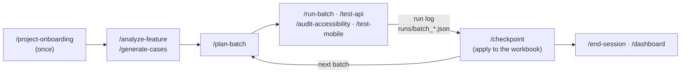

# QA Assistant — AI-Assisted Quality Engineering Framework

[](https://github.com/pedroalmeida981/qa-assistant/actions/workflows/ci.yml)

**Active development · Python 3.12+ · Claude Code · Playwright · QA automation**

QA Assistant is a personal framework for planning, executing and reviewing quality-assurance work. It combines **Claude Code-assisted testing workflows**, a standalone **website audit engine (`qa-audit`)**, and a **local QA interface (`qa-ui`)**. The aim is repeatable test execution with traceable evidence and explicit human approval for decisions and tracker updates.

Built as a practical quality-engineering project: **source code, tests, a fictional demo, CI and technical documentation are included**. Real client workspaces, credentials, reports and evidence are intentionally kept outside this public repository.

> **Development status (October 2026):** This is an actively evolving project, **not a finished commercial product**. The workspace layer reached v1.0 after a controlled pilot; `qa-audit` has its own v0.2.0 release; the one-workspace UI exists, while the multi-project hub is being delivered in phases. The last verified main-branch CI run before this documentation change was successful on 21 October 2026. See [development status](#state) and the [development plan](docs/development-plan.md) for limitations.

> **License:** Publicly viewable **proprietary source**, not an open-source project. See [LICENSE](LICENSE) before copying, adapting or redistributing any part of it. Third-party components retain their own licences.

## At a glance

| Component | What it offers | Current evidence / boundary |
| --- | --- | --- |
| **QA workspaces** | Claude Code skills for analysis, test cases, batches, run logs, checkpoints and dashboards | Versioned methodology and a documented public-site pilot; client data remains in separate workspaces |
| **`qa-audit` CLI** | Browser-based accessibility, passive security, functional, performance and opt-in visual checks | Python implementation, example configuration and browser integration tests in CI; not a security penetration test or accessibility certification |
| **`qa-ui`** | Local intake, test suggestions, batch execution, approval flows and results | One-workspace mode implemented; new Projects hub supports discovery and pinning, with other multi-project screens still planned |
| **Trackers** | Excel, Jira/Xray and Azure DevOps adapters | Unit tests, fakes and golden fixtures; real pilots of the remote tracker adapters are still pending |
| **Mobile / remote execution** | Mobile workflows and GitHub Actions workspace templates | Implemented tooling and tests; a full runner-based mobile pilot remains pending |

## Start here

- **Try `qa-audit`:** Follow the [installation and user guide](docs/qa-audit-guide.md) and run only against sites you own or are authorised to test.
- **See an example:** Explore the [fictional demo workspace](examples/demo/) and its [Playwright specs](examples/demo/e2e/specs/).
- **Understand the design:** Read the [methodology](docs/methodology.md), [architecture](#layered-architecture), [interface specification](docs/qa-ui.md), and [development plan](docs/development-plan.md).
- **Inspect quality controls:** [GitHub Actions CI](.github/workflows/ci.yml), [tests](tests/), [privacy and secret guards](#privacy-boundary), and [changelog](CHANGELOG.md).


---

## qa-audit — automated audit engine

An automated first pass over any website, from its URL alone. It lives alongside the workspace layer.

```bash
./scripts/install.sh            # Windows: .\scripts\install.ps1  (.venv, package, Chromium, then qa-audit doctor)
. .venv/bin/activate            # Windows: .\.venv\Scripts\Activate.ps1
qa-audit https://example.com                         # every available module
qa-audit https://example.com --type accessibility --browser firefox --max-pages 5
```

It can log in first (a form, or you log in by hand for Active Directory / 2FA). It crawls the start origin with GET navigation only (never clicks, types or submits; skips logout/delete-style
links, respects `robots.txt`), runs the selected modules on each page, and writes `qa-output/<timestamp>/` with
screenshots, `results.json`, `results.csv`, `report.md` and a self-contained `report.html`. No telemetry; nothing
is sent anywhere but to the target. Only audit sites you own or are authorized to test.

Modules today: **accessibility** (axe-core 4.13.0 bundled, keyboard walk with focus visibility decided by pixels,
reflow, manual checklist) and **security** (passive: HTTPS/TLS, security headers, cookie flags, mixed content) and
**performance** (TTFB, FCP, LCP, CLS against the web.dev thresholds; sizes and timings measured) and **functional**
(broken links and resources, JavaScript errors, redirect chains, form checks; forms are submitted only with
`--allow-submit` and when listed in the configuration) and **visual** (screenshots per viewport against baselines
kept outside any repository, horizontal overflow; `pip install -e .[visual]`). Pages behind a login: a login form,
a person logging in (Active Directory, second factor), or a session saved once with `qa-audit login`. User guide:
[`docs/qa-audit-guide.md`](docs/qa-audit-guide.md) (install, run, results, new projects, new modules, client data);
example: [`examples/qa-audit/`](examples/qa-audit/). Specification: [`docs/qa-audit.md`](docs/qa-audit.md);
contributing: [`CONTRIBUTING.md`](CONTRIBUTING.md); changes: [`CHANGELOG.md`](CHANGELOG.md).

---

## Layered architecture

| Layer | What it is | Where it lives |
|---|---|---|
| **1. Methodology** | The method: analysis, case design, batches, decision rules (Pass/Fail/N/A/Blocked/Question), bugs, checkpoints; anonymised heuristics for *error guessing* | [`docs/methodology.md`](docs/methodology.md), [`docs/heuristics.md`](docs/heuristics.md) |
| **2. Techniques** | How to test each type: [browser](docs/technique-browser.md), [API](docs/technique-api.md), [accessibility](docs/technique-accessibility.md), [mobile](docs/technique-mobile.md), [Excel workbooks](docs/technique-excel.md) | `docs/` |
| **3. Adapters and tools** | Universal Excel adapter, scripts for API, accessibility, mobile, dashboard and validation; skills. They are the framework's engine: there is no separate core | `adapters/`, `scripts/`, `.claude/skills/` |
| **4. Workspace** | The project: `CLAUDE.md`, `project.yaml`, `context.md`, workbook, `.env`, run log | `qa-workspaces/<company>/<project>/` (outside this repository) |

The hierarchy of sources of truth, the generalisation rule (what is universal vs. what belongs to a project) and the process for changing the framework are in the methodology (§1.3, §1.4, §15).

## Privacy boundary

Nothing that identifies a client enters this repository: names, environment URLs, accounts, credentials, workbooks, results or bugs of real projects. Two barriers in `pre-commit`, never worked around:

- **detect-secrets**, with a baseline;
- **personal denylist** (`~/.qa-denylist.txt`, outside the repository): blocks client names in the text, in the file names and **inside** Office files (`.xlsx`, `.docx`, `.pptx`), and in the commit message.

Credentials live only in each workspace's `.env` and are referred to by the variable's name. The scripts pass them through environment variables, never on the command line, and redact the evidence (e.g. `scripts/api_request.py` replaces tokens and passwords with `«redacted»`). In the workspace, `validate_project` warns if `.env` and the like are not in `.gitignore`, and `.claude/settings.json` forbids Claude Code from editing `history/`, which is immutable.

## How to work



The generated cases are proposals until the user approves them; a bug is only created once approved; the results go to the workbook only at the checkpoint, through the adapter, and only if the batch is valid and the cross-check gives 0 problems.

### The local interface (`qa-ui`)

`qa-ui` is a **local-only interface** for planning and supervising QA work, with user approval before changes are applied to the project's tracker. In the current single-workspace mode, it supports case intake, test-module suggestions, batch planning, runs, review of proposed bugs/questions and applying approved results through the configured adapter.

```bash
python -m qa_ui ../qa-workspaces/<company>/<project>  # One workspace: complete existing flow
python -m qa_ui                                   # Multi-project hub: Projects view and pinning
```

The interface binds to `127.0.0.1` and uses a per-start token. Workspaces and any sensitive project data remain outside this repository. Run logs and tracker updates are controlled by the workflow's approval rules; `qa-ui` does not commit project history.

**Multi-project hub — work in progress (phase 13):** Project discovery, the Projects screen, pinning and a shared one-run-at-a-time guard are implemented. As of 21 October 2026, opening a project from the hub still uses its single-workspace view; integrated navigation, project creation and the remaining management screens are planned, **not yet presented as completed**. See [the hub specification](docs/qa-ui.md#14-the-hub-every-project-in-one-interface-plan-phase-13) and [phase 13 of the development plan](docs/development-plan.md#phase-13--the-hub-every-project-in-qa-ui).

### Starting a new project

1. Create the folder `qa-workspaces/<company>/<project>/` (next to this repository).
2. Open `claude` in that folder and run `/project-onboarding`: it creates `CLAUDE.md`, `project.yaml` and `.claude/settings.json` (protection of `history/`), asks about environments, roles, tracker and modules, inspects the real workbook (`python -m adapters.excel.inspect`) or, with Jira or Azure DevOps, fills in the tracker's section and runs `check` and `import-cases`, registers the Playwright MCP with a fixed version and ends with `python scripts/validate_project.py <workspace>` without problems (it also checks that the modules' URLs belong to declared test environments).
3. Fill in `.env` locally.

### Modules

| Module | Technique | Skill | Tool |
|---|---|---|---|
| `functional-web`, `exploratory` | browser | `/run-batch` | Playwright MCP |
| `api` | API | `/test-api` | `scripts/api_request.py` |
| `accessibility` | WCAG 2.1 AA | `/audit-accessibility` | `scripts/audit_a11y.py` (`qa-audit` engine: axe-core, keyboard, reflow) |
| `mobile` | Maestro | `/test-mobile` | `scripts/run_mobile.py` |

### Trackers

Each tracker has an adapter. Excel: the results and the bugs go to the workbook at `/checkpoint`, the cases approved in `/generate-cases` are added by the adapter (`python -m adapters.excel.add_cases`, never by hand), and there is a dashboard. Jira with Xray and Azure DevOps Test Plans (`python -m adapters.tracker`, specified in `docs/technique-jira-xray.md` and `docs/technique-azure-devops.md`): results, bugs (with a duplicate search), importing and exporting cases — always a dry run first and `--yes` only after the user's approval, a batch never sent twice; the skills use them the same way (`/plan-batch` and `/run-batch` read the imported cases, `/log-bug` searches duplicates, `/checkpoint` sends, `/generate-cases` exports); their progress view is the tracker's own reports (methodology §4.2).

## Demo

[`examples/demo/`](examples/demo) is a complete workspace against public practice sites ([saucedemo.com](https://www.saucedemo.com) and the [restful-booker](https://restful-booker.herokuapp.com) API), with 38 cases in 6 areas, batches run in `runs/`, 3 example bugs, Maestro flows and Playwright regression specs (`e2e/`). The workbook is rebuilt from the builder and the batches (`python examples/demo/rebuild_workbook.py`), with each batch's execution date, and always gives the same cells (the CI checks it against the versioned workbook); `python scripts/build_dashboard.py examples/demo --open` shows the progress dashboard.

## Tests and CI

- `python -m unittest discover -s tests` — the unit tests (adapter, inspection, recalculation, dashboard, summary, API, accessibility, mobile, validation, workspace migration, the scripts' common code, denylist, guards, skills, console, language, reproducible demo, real golden, and the `qa-audit` engine's unit tests). Those that need LibreOffice are *skipped* without it. The `qa-audit` integration tests (a real browser against a local site) run with `python -m unittest discover -s tests/integration`.
- `python scripts/golden_check.py` — golden test of the Excel adapter (needs LibreOffice). With `--dir <workspace>/golden/<batch>` it also runs a project's **real** golden: a historical batch applied to a copy of the workbook from before must give, cell by cell, the workbook saved afterwards (the data stays in the workspace).
- The CI (GitHub Actions, Ubuntu 24.04) runs 7 jobs on each push: `lint` (ruff), `tests`, `secrets` (detect-secrets), `golden` (golden, summary with real formulas, reproducible demo and real golden with fictional data, with LibreOffice), `demo-e2e` (the demo's Playwright specs against the public site), `qa-audit` (engine integration in Chromium, Firefox and WebKit) and `install` (clean clone, install, audit of the local site). `pre-commit` runs the same locally, plus the denylist on the files and on the commit message.
- Fixed versions: exact Python dependencies (`requirements.txt`), ruff, detect-secrets and Playwright MCP; a test prevents going back to loose versions.

The skills run from the global copy in `~/.claude/skills/` (the workspaces live outside this repository): after changing a skill, `python scripts/sync_skills.py --apply` (it also removes the skills' old names).

Requirements: Python 3.12+ (`pip install -r requirements.txt`), LibreOffice (workbook recalculation), Node.js 22+ (accessibility and specs), Maestro CLI (mobile).

## State

**Active development (October 2026).** The workspace workflow has a v1.0 milestone (25 September 2026) and `qa-audit` is separately versioned at v0.2.0. The local `qa-ui` work and the multi-project hub are newer and ongoing. Completed items in the plan are not a claim that every adapter has been piloted against a live external tracker or that every multi-project UI feature is already implemented.

| Phase | State |
|---|---|
| 0–1 · Base and core (skills, Excel adapter, golden) | Done |
| 2 · Browser (Playwright MCP, demo, N2 regression, pilot) | Done |
| 3 · API, accessibility and mobile modules | Done |
| 4 · The framework's CI | Done |
| 5 · Dashboard per workspace | Done |
| 6 · Portfolio (README, demo, visibility: public) | Done |
| 7 · Closing (general review, CI on Linux, pilot, real golden, protected `history/`, fixed versions, reproducible demo) | Done: **v1.0** |
| 8 · `qa-audit` engine and translation | 8.0–8.17 (0.2.0: login, saved sessions, sitemap, several browsers; `check`, focus by pixels; 8.11 everything in English) |
| 12 · `qa-ui` single-workspace interface | Implemented and tested with fixtures; a mobile-workspace pilot was recorded in October; a web-site pilot is still pending |
| 13 · `qa-ui` multi-project hub | Projects discovery, pinning and single-run guard implemented; in-hub navigation, project creation and other management screens remain planned |

**Pilot** (25.09.2026): in a workspace outside the repository, with a public practice site (no access to company projects). A batch of 16 cases, 10 new and 6 retests, run by a `claude` session in the workspace with the Playwright MCP and applied to the workbook at `/checkpoint`: the retests gave the same status as before; real golden passing; protection of `history/` confirmed. Lessons incorporated: Playwright MCP with `--secrets .env` (the assistant never sees the credentials) and `--isolated` (the persistent profile lost clicks), warnings of `validate_project` for `.mcp.json`, and the denylist also on the commit message.

Scope decisions: the adapters and the scripts are the workspace layer's engine, and `qa-audit` is a separate engine, next to it (25.09.2026); the `executor-web` subagent is not created (the pilot ran in its own session without filling the main context); Jira and Azure DevOps stayed as manual logging until the user's decision of 28.09.2026 to build their adapters (plan phase 10).
